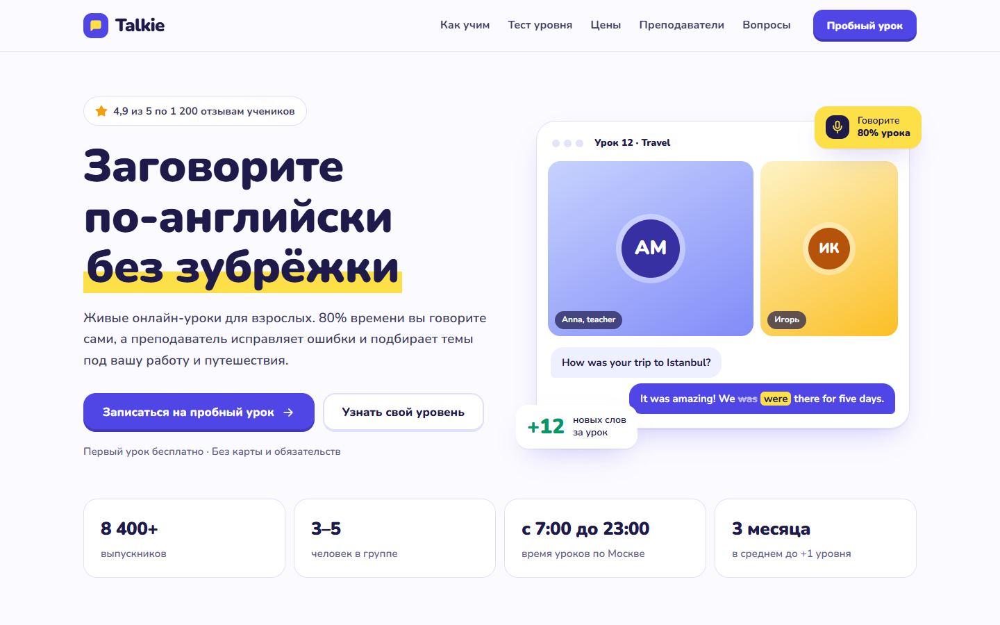

# Talkie: лендинг онлайн-школы английского

Демо-концепт лендинга школы разговорного английского для взрослых.

**[Открыть демо](https://grozeser.github.io/english-landing/)**



## Что внутри

- Тест уровня: 5 вопросов от A1 до B2, результат с рекомендацией и автоматическая подстановка уровня в заявку
- Макет живого урока на первом экране с исправлением ошибки в чате
- Форматы обучения и цены, преподаватели, отзывы, частые вопросы
- Форма записи на пробный урок с проверкой полей
- Адаптив под телефон: меню-бургер, крупные кнопки, без горизонтальной прокрутки

## Стек

HTML, CSS, JavaScript без фреймворков и сборки. Шрифт Nunito, иконки в SVG.

## Запуск

Откройте `index.html` в браузере или запустите любой статический сервер:

```bash
python -m http.server 8000
```

Школа, преподаватели, отзывы и цены вымышленные. Форма ничего не отправляет.
